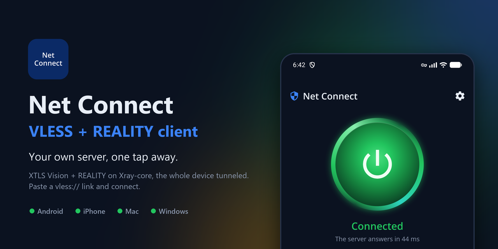

# VLESS + REALITY VPN client

For Android, iOS, macOS and Windows.

For now "Net Connect" is a placeholder generic name.

Downloads: [latest release](https://github.com/taublast/DrawnVpnClient/releases/latest)

Written in Rust, its UI drawn with [DrawnUI for Rust](https://github.com/DrawnUi/DrawnUi.Rust). The tunnel runs on [Xray-core](https://github.com/XTLS/Xray-core).
